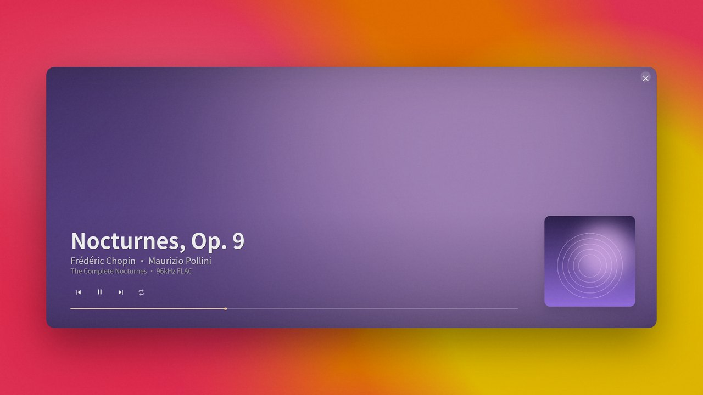
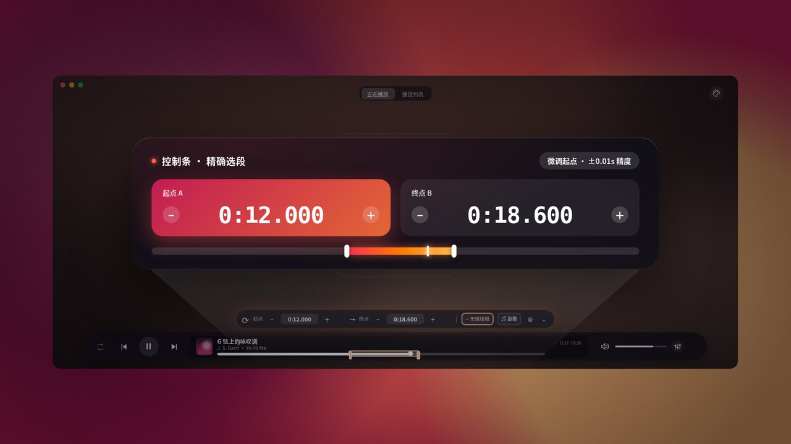
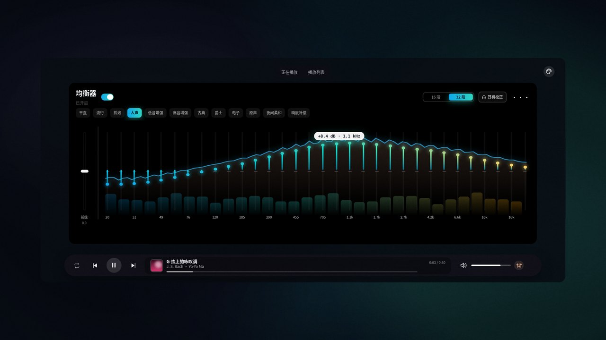
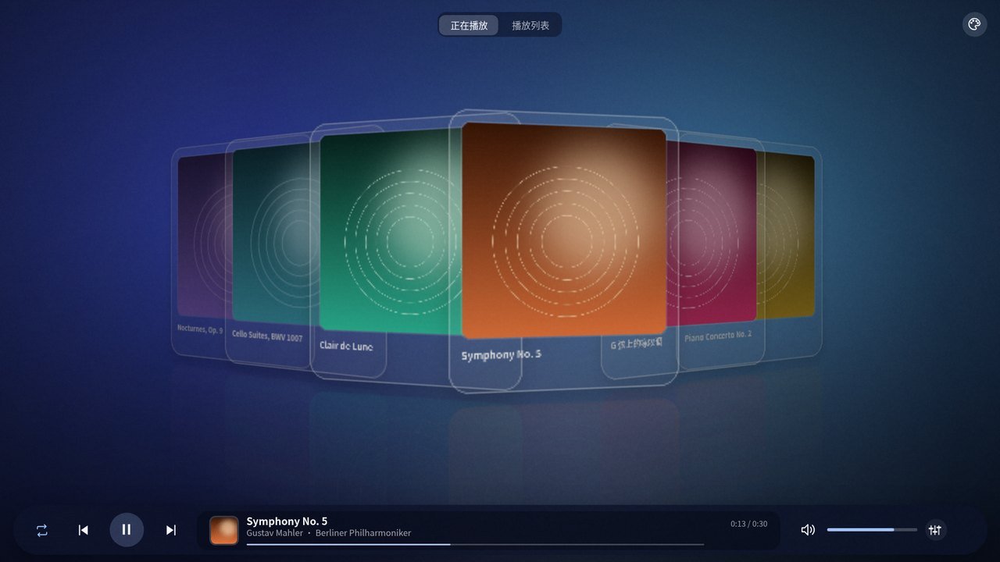

# 琉璃宣传片模板 · Liuli Promo Film Template

一套「用网页写的 4K60 产品宣传片」工程：画面用 HTML / CSS / GSAP 搭，每一帧都由 `window.seek(t)` 算出来，再用无头 Chromium 逐帧截图、ffmpeg 合成视频。改文字、换素材、调时间轴，重新渲染即可。

A product-promo film built as a web page: HTML/CSS/GSAP scenes, every frame a pure function of `window.seek(t)`, captured frame by frame with headless Chromium and encoded with ffmpeg.

[中文](#中文) · [English](#english) · License: MIT

| | |
|---|---|
|  |  |
|  |  |

（截图用的是仓库自带的占位素材。/ Screenshots use the bundled placeholder artwork.）

---

## 中文

### 特点
- **确定性渲染**：画面只取决于时间 t，可任意跳帧、分段并行渲染，重渲结果逐帧一致。
- **原生 4K**：舞台按 1920×1080 设计，在 3840×2160 视口里 2 倍栅格化；也可以直接出 1080p。
- **分层工程**：`film/` 里的 `v*.js / v*.css` 是一层层叠加的场景与修订，`index.html` 按顺序加载；删掉某一层的引用就回到上一版。
- **完整管线**：预览截帧（`render/preview.py`）→ 逐帧渲染（`render/render.py`）→ 收尾（`render/finish.sh`：颗粒、可选纹理叠加、配乐与片尾音效混音）。

### 目录
```
film/                 宣传片本体（直接用浏览器打开 index.html 也能预览）
  index.html          入口，按顺序加载各层脚本和样式
  timeline.json       章节与时间轴
  themes.json         配色主题数据
  audio-config.js     配乐节拍网格（下拍时间点），镜头卡点用
  assets/             占位素材、开源字体（OFL）、音频分析数据
render/               预览、渲染、收尾脚本
tools/                占位素材生成、音频分析、下载 GSAP
```

### 快速开始
```bash
pip install playwright pillow numpy && python3 -m playwright install chromium
bash tools/fetch_gsap.sh                    # 下载 GSAP 到 film/assets/（不随仓库分发）
python3 render/preview.py out/stills 2 12 33 62     # 抽几帧看看
python3 render/render.py --width 1920 --height 1080 --fps 30 --out out/raw-1080p.mp4   # 先出个小样
python3 render/render.py                     # 4K60 正式渲染（69.5 秒，耗时较长，--workers 调并行数）
bash render/finish.sh out/raw.mp4 out/final.mp4 my-music.wav [texture.png] [ending-sting.wav]
```
已装 Chrome 的话可以 `CHROME_PATH=/usr/bin/google-chrome` 指定浏览器。

### 换成你自己的素材
| 文件 | 用途 | 规格 |
|---|---|---|
| `film/assets/01..06-diy-vector.svg` | 轮播封面 | 正方形，SVG 或同名替换 |
| `film/assets/classical-01..07.jpg` | 专辑封面（高潮段、收尾） | 正方形，建议 2400×2400 |
| `film/assets/fan-normal.svg / .png` | 开场与片尾 Logo | 1024×1024 |
| `film/v20.js` 里的 `FAN_PATH_D` | 开场展开动画用的 Logo 路径 | 0–1 单位坐标的 SVG path |
| `film/tracks-data.js`、`film/v20.js` 的曲目表 | 曲名、艺人 | 文本 |
| `film/v20.js` 片尾 `ve-text`、`timeline.json` | 片尾文字（默认是示例品牌名） | 文本 |
| `film/audio-config.js` | 配乐下拍时间点 | 秒 |
| `film/assets/audio-analysis.json` | 波形与频段数据 | `python3 tools/make_audio_analysis.py 你的配乐.wav` 生成 |

`python3 tools/make_placeholders.py` 可以重新生成全部占位图。配乐、片尾音效和纹理图不随仓库提供，渲染时在 `finish.sh` 里传入你有授权的文件。

### 许可
- 代码：MIT，© 2026 Luna Fantasy Lab，见 [LICENSE](LICENSE)。可以商用。
- 字体：Noto Sans SC、Pretendard，均为 SIL Open Font License，许可文本在 `film/assets/fonts/`。
- GSAP 不随仓库分发，按其官方许可使用（`tools/fetch_gsap.sh` 下载）。
- 示例文案里出现的产品名和工作室名是 Luna Fantasy Lab 的品牌名，不在 MIT 许可范围内，请换成你自己的。

---

## English

### Highlights
- **Deterministic**: every frame depends only on `t`, so you can seek anywhere, render chunks in parallel and get identical results on re-render.
- **Native 4K**: the stage is designed at 1920×1080 and rasterized at 2× in a 3840×2160 viewport; 1080p output works too.
- **Layered project**: the `v*.js / v*.css` files in `film/` are stacked scene and revision layers loaded in order by `index.html`; remove a layer's tags to roll back to the previous version.
- **Full pipeline**: stills preview (`render/preview.py`) → frame capture (`render/render.py`) → finishing (`render/finish.sh`: grain, optional texture overlay, soundtrack and end-sting mix).

### Quick start
```bash
pip install playwright pillow numpy && python3 -m playwright install chromium
bash tools/fetch_gsap.sh                    # GSAP is downloaded, not redistributed
python3 render/preview.py out/stills 2 12 33 62
python3 render/render.py --width 1920 --height 1080 --fps 30 --out out/raw-1080p.mp4
python3 render/render.py                     # full 4K60 render (69.5 s)
bash render/finish.sh out/raw.mp4 out/final.mp4 my-music.wav [texture.png] [ending-sting.wav]
```
Set `CHROME_PATH` to use an installed Chrome.

### Bring your own assets
Replace the placeholder covers, album art and logo in `film/assets/` (same file names), the `FAN_PATH_D` logo path in `film/v20.js`, track names in `film/tracks-data.js` / `film/v20.js`, the end-card text, the beat grid in `film/audio-config.js`, and regenerate `audio-analysis.json` from your soundtrack with `tools/make_audio_analysis.py`. Music, end sting and texture are not included; pass your own licensed files to `finish.sh`.

### License
- Code: MIT, © 2026 Luna Fantasy Lab ([LICENSE](LICENSE)). Commercial use is allowed.
- Fonts: Noto Sans SC and Pretendard, SIL Open Font License (texts in `film/assets/fonts/`).
- GSAP is not redistributed; it is used under its own license.
- The product and studio names in the sample copy are brand names of Luna Fantasy Lab and are not covered by the MIT license; replace them with your own.
